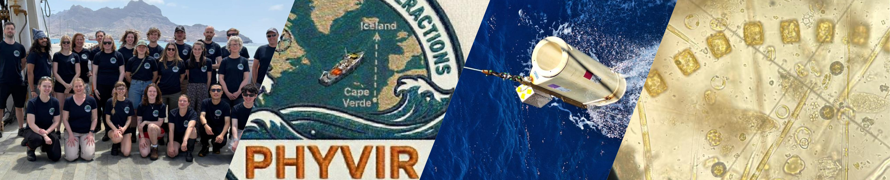

:::{.callout-important}
Page under construction - registration not yet open. Please check back later for updates.
:::

**June-July | Azores to Iceland | approximately one month | 10–12 MSc students**

The PHYVIR consortium invites MSc students enrolled at Dutch universities to participate in a one-time, hands-on summer class embedded within a scientific expedition across the North Atlantic Ocean.

The class offers an opportunity to experience marine research from the inside: living and working aboard a research vessel, participating in oceanographic sampling and onboard analyses and working directly with researchers studying phytoplankton, viruses, microbial communities and the ocean environment.

## **What is PHYVIR?**

Microscopic phytoplankton form the foundation of marine food webs, contribute roughly half of global primary production and oxygen production, and play a major role in global carbon and nutrient cycles. Phytoplankton are grazed but also infected by viruses.

These viruses can kill large numbers of phytoplankton cells, alter the composition of marine communities, and redirect carbon and nutrients through the ocean ecosystem. Yet we still know surprisingly little about how important these processes are at larger spatial scales or how they may change as the oceans warm and environmental conditions shift.

[PHYVIR — Resolving Marine Phytoplankton–Virus Interactions from Local to Global Scales](https://www.nioz.nl/en/research/projects/phyvir) brings together researchers in marine viral ecology, phytoplankton ecology and physiology, biological oceanography, multiomics, bioinformatics and ecological modelling. The project combines laboratory experiments, environmental 'omics, oceanographic expeditions and mathematical models to investigate functional traits of phytoplankton and viruses, and to understand how phytoplankton–virus interactions affect marine ecosystems and global biogeochemical cycles.

PHYVIR is coordinated by **Prof. Corina Brussaard at NIOZ — Royal Netherlands Institute for Sea Research**, together with researchers at NIOZ, the University of Amsterdam, the Netherlands Institute of Ecology (NIOO-KNAW), and the University of Groningen.

## **The expedition**

The PHYVIR research cruise will take place in the **North Atlantic Ocean along a latitudinal gradient**, crossing different oceanographic provinces along the way.
The scientific team will investigate how environmental conditions, phytoplankton communities and their viruses change from (sub)tropical to subpolar waters. The different variables will include oceanographic conditions, microbial abundances and biomass, phytoplankton activity and cellular composition, phytoplankton loss rates, multi-omics of phytoplankton and virus communities.

As a participant in the summer class, you will join this expedition as part of the scientific team rather than follow a separate classroom. Check out this year’s [PHYVIR expedition blog](https://www.nioz.nl/en/news-and-blogs/blog/phyvir-expedition) for first-hand impressions.

## **What will you do?**

The precise programme will depend on the scientific activities and conditions at sea. Daily tasks will be linked to one of the PHYVIR subprojects, led by different supervisors. Activities may include:

* participating in oceanographic sampling operations;
* collecting seawater and other environmental samples;
* processing samples onboard;
* microscopy, flow cytometry and other measurements of microbial communities;
* phytoplankton photophysiology and elemental composition
* rate measurements of viral lysis, grazing and sinking of phytoplankton;
* preparation of samples for molecular and genomic analyses;
* working with environmental, biological or genomic datasets;
* discussing research activities with researchers aboard the vessel;
* short lectures, demonstrations, small assignments, and scientific discussions linked directly to the ongoing research.

You will experience the full research process – from sampling an ocean water mass to interpreting the resulting biological data – and see how different disciplines are combined during a major field expedition.

## **Research themes and supervisors**

You will not apply for a predefined project. Instead, we ask you to indicate which PHYVIR PI’s **research themes** most closely match your interests. This will help us understand your scientific interests and, where possible, connect participants with researchers during and potentially before or after the cruise.

Corina Brussaard — marine viral ecology · phytoplankton–virus interactions · microbial oceanography · loss rates . loss rates · environmental change · flow cytometry

Jef Huisman — phytoplankton ecology · community dynamics · species interactions · ecological modelling

Dedmer van de Waal — phytoplankton ecophysiology · cellular compositionstoichiometrycellular composition · functional traits · environmental change

Susanne Wilken — aquatic microbial ecology · microbial interactions · eukaryotic microbes · mixotrophy · transcriptomics

Cara Nissen — marine carbon cycling · marine ecosystem dynamics · biogeochemical modelling

Thomas Hackl — viral genomics · environmental metagenomics · bioinformatics · sequencing · microbial eco-evolution

**Guy, Yeal, Paula, ???**

## **Who is eligible?**

You can apply if you:

* are enrolled in an MSc programme at a Dutch university for the duration of the cruise;
* have a background in biology, molecular sciences, modelling or another closely related discipline;
* have taken courses in marine biology, oceanography, aquatic ecology, microbiology, molecular biology, bioinformatics, or related fields;
* have a collaborative and practical attitude, ideally but not required, with laboratory or field experience;
* are enthusiastic about marine science and interdisciplinary research;
* are available and committed for the full cruise period and required pre-cruise training.

Prior experience at sea is **not required**. We are particularly looking for students who are curious, motivated to participate actively in research, comfortable working in a team, and interested in learning across disciplinary boundaries.

## **Is this part of my MSc programme?**

The summer class is offered as an **extracurricular activity** and does not automatically carry ECTS.

However, one aim of the PHYVIR programme is to establish longer-term connections with participating students. Where possible, we will therefore support participants who want to discuss with their home university whether their participation can contribute to an MSc project, internship or other credit-bearing activity.

Participation in the class does **not** require you to already have a PHYVIR research project or to submit a project proposal with your application.

## **What is it like to work aboard a research vessel?**

Research cruises are exciting, but they are also intensive.

Scientific work at sea is determined partly by sampling schedules, weather and the availability of equipment. Activities may therefore take place outside conventional office hours. Participants should be prepared to work flexibly and contribute actively to the shared scientific work aboard the ship.

Space aboard is limited, and therefore, you will share your cabin with another participant. We will take gender into account during allocation.

All work will take place within the applicable maritime safety and working-time regulations. Safety procedures and instructions from the ship’s crew and scientific leadership must always be followed.

Living and working together for several weeks also requires flexibility, consideration for others and a willingness to contribute to a collaborative working environment.

## **Costs and required preparation**

For selected participants, PHYVIR will cover:

* participation in the summer class and research cruise;  
* required sea-survival training;  
* travel to and from the ship;  
* accommodation where required for the programme;  
* food and drinks on board.

Participants should expect to arrange and contribute to certain personal requirements, including:

* the required medical examination for the standard “seafarer’s medical fitness certificate”  
* appropriate safety footwear
* personal clothing/equipment
* food and drinks during travel to and from the ship.

Detailed instructions will be provided to selected students.

Participation will be conditional on successful completion of all required safety and medical procedures.

## **How are students selected?**

We expect to select **10–12 students**.

Selection will be based primarily on:

1. your motivation for participating;
2. the relevance of your academic background and potential previous experience;
3. your willingness to participate actively in the scientific work aboard the vessel;
4. the match between your interests and the scientific scope of PHYVIR.

We also aim to assemble a diverse class while bringing together students from universities across the Netherlands.

## **How to apply**

:::{.callout-important}
Page under construction - registration not yet open. Please check back later for updates.
:::

Please complete the [**application form**](https://forms.gle/iS41FhhhLfD139ncA) before **December 31, 2026** (https://forms.gle/iS41FhhhLfD139ncA)

You will be asked to submit:

* a **motivation letter** explaining why you would like to participate and what you hope to learn (suggestion: maximum 1 page)
* an indication of the PHYVIR PI/research themes that most closely match your scientific interests.

Do **not** prepare a research proposal or choose a specific PHYVIR subproject.

Applicants will be informed of the selection outcome by **February 1, 2027**.

## **Key dates**

| Application deadline | December 31, 2026 |
| :---- | :---- |
| **Selection outcome** | February 1, 2027 |
| **Sea-survival training** | *TBD* |
| **Cruise Dates** | June 8 – July 6, 2027 |
| **Travel to/from ship** | 1-2 extra days before and after the cruise |

## **Questions?**

For questions about the summer class or the application process, contact:

**Thomas Hackl \- t.hackl@rug.nl**
