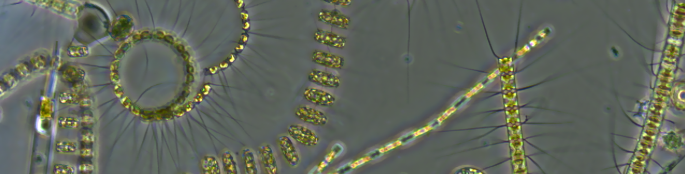

**[DATES] | Cape Verde → Iceland | approximately one month | 10–12 MSc students**

The PHYVIR consortium invites MSc students enrolled at Dutch universities to participate in a one-time, hands-on summer class embedded within a scientific expedition across the North Atlantic Ocean.

The class offers an opportunity to experience marine research from the inside: living and working aboard a research vessel, participating in oceanographic sampling and onboard analyses, and working directly with researchers studying phytoplankton, viruses, microbial communities and the ocean environment.

## What is PHYVIR?

Microscopic phytoplankton form the foundation of marine food webs, contribute roughly half of global primary production and oxygen production, and play a major role in global carbon and nutrient cycles. But phytoplankton are also infected by viruses.

These viruses can kill large numbers of phytoplankton cells, alter the composition of marine communities, and redirect carbon and nutrients through the ocean ecosystem. Yet we still know surprisingly little about how important these processes are at larger spatial scales or how they may change as the oceans warm and environmental conditions shift.

**PHYVIR — Resolving Marine Phytoplankton–Virus Interactions from Local to Global Scales** brings together researchers in marine viral ecology, phytoplankton ecology and physiology, biological oceanography, genomics, bioinformatics and ecological modelling. The project combines laboratory experiments, environmental genomics, oceanographic expeditions and mathematical models to understand how phytoplankton–virus interactions affect marine ecosystems and global biogeochemical cycles.

PHYVIR is coordinated by **Prof. Corina Brussaard at NIOZ — Royal Netherlands Institute for Sea Research**, together with researchers at NIOZ, the University of Amsterdam, the Netherlands Institute of Ecology (NIOO-KNAW), and the University of Groningen.

## The expedition

The PHYVIR research cruise will travel through the **North Atlantic from Cape Verde to Iceland**, crossing very different oceanographic regions along the way.

Across this gradient, the scientific team will investigate how environmental conditions, phytoplankton communities and their viruses change from subtropical to subpolar waters. Measurements will include oceanographic conditions, phytoplankton community composition and activity, viral abundance and infection, microbial diversity and molecular characteristics of the communities.

As a participant in the summer class, you will join this expedition as part of the scientific team rather than follow a separate classroom programme.

## What will you do?

The precise programme will depend on the scientific activities and conditions at sea. Activities may include:

- collecting seawater and other environmental samples;
- participating in oceanographic sampling operations;
- processing samples onboard;
- microscopy, flow cytometry and other measurements of microbial and phytoplankton communities;
- measurements related to phytoplankton physiology and viral infection;
- preparation of samples for molecular and genomic analyses;
- working with environmental, biological or genomic datasets;
- discussing experiments and results with researchers aboard the vessel;
- short lectures, demonstrations and scientific discussions linked directly to the ongoing research.

You will experience the full research process — from sampling an ocean water mass to interpreting the resulting biological data — and see how different disciplines are combined during a major field expedition.

## Research themes and supervisors

You will not apply for a predefined project. Instead, we ask you to indicate which PHYVIR PI's **research themes** most closely match your interests. This will help us understand your scientific interests and, where possible, connect participants with researchers during and potentially before or after the cruise.

### Corina Brussaard — NIOZ / UvA

*marine viruses · viral ecology · phytoplankton–virus interactions · viral lysis · microbial oceanography · biogeochemical cycling*

### Jef Huisman — University of Amsterdam

*phytoplankton ecology · aquatic microbial ecology · species interactions · resource competition · community dynamics · ecological modelling*

### Dedmer van de Waal — NIOO-KNAW

*phytoplankton ecophysiology · ecological stoichiometry · nutrients · functional traits · environmental stressors · global change*

### Susanne Wilken — University of Amsterdam

*aquatic microbial ecology · eukaryotic microbes · microbial interactions · resource acquisition · mixotrophy · carbon and nutrient cycling*

### Cara Nissen — University of Amsterdam

*marine carbon cycling · marine ecosystem dynamics · biogeochemical modelling · ecosystem modelling · high-latitude processes*

### Thomas Hackl — University of Groningen

*environmental genomics · marine microbial communities · viral genomics · bioinformatics · sequencing · microbial ecology and evolution*

### Guy, Yeal, Paula, ???

## Who is eligible?

You can apply if you:

- are **enrolled in a Master's programme at a Dutch university** at the time of the summer class;
- have a biological or closely related scientific background;
- have relevant coursework, preferably including marine biology, oceanography, aquatic ecology, microbiology, molecular biology, genomics, bioinformatics or related subjects;
- have some prior hands-on research experience, which may be laboratory, field-based or computational;
- can participate for the **entire cruise period** and in mandatory preparations and safety training.

Prior experience at sea is **not required**.

We are particularly looking for students who are curious, motivated to participate actively in research, comfortable working in a team, and interested in learning across disciplinary boundaries.

## Is this part of my MSc programme?

The summer class is offered as an **extracurricular activity** and does not automatically carry ECTS.

However, one aim of the PHYVIR programme is to establish longer-term connections with participating students. Where possible, we will therefore support participants who want to discuss with their home university whether their participation can contribute to an MSc project, internship or other credit-bearing activity.

Participation in the class does **not** require you to already have a PHYVIR research project or to submit a project proposal with your application.

## What is it like to work aboard a research vessel?

Research cruises are exciting, but they are also intensive.

Scientific work at sea is determined partly by sampling schedules, weather and the availability of equipment. Activities may therefore take place outside conventional office hours. Participants should be prepared to work flexibly and contribute actively to the shared scientific work aboard the ship.

All work will take place within the applicable maritime safety and working-time regulations. Safety procedures and instructions from the ship's crew and scientific leadership must always be followed.

Living and working together for several weeks also requires flexibility, consideration for others and a willingness to contribute to a collaborative working environment.

## Costs and required preparation

For selected participants, PHYVIR will cover:

- participation in the summer class and research cruise;
- required **sea-survival training**;
- travel associated with participation in the class;
- accommodation where required for the programme;
- meals during the cruise and other programme-related subsistence costs.

Participants should expect to arrange and contribute to certain personal requirements, including:

- the required **maritime medical examination/certificate**;
- appropriate **safety footwear** and specified personal clothing/equipment.

Detailed instructions will be provided to selected students.

Participation will be conditional on successful completion of all required safety and medical procedures.

## How are students selected?

We expect to select **10–12 students**.

Selection will be based primarily on:

1. your motivation for participating;
2. the relevance of your academic background and previous experience;
3. the match between your interests and the scientific scope of PHYVIR;
4. your willingness to participate actively in the scientific work aboard the vessel.

We also aim to assemble a diverse class representing **different Master's programmes and Dutch universities**.

You do not need to be an expert in marine virology. We are looking for students with a solid scientific basis who are motivated to learn.

## How to apply

Please complete the application form at **https://forms.gle/iS41FhhhLfD139ncA** by **[DEADLINE]**.

You will be asked to submit:

- a **motivation letter** explaining why you would like to participate and what you hope to learn;
- an indication of the PHYVIR PI/research themes that most closely match your scientific interests.

Do **not** prepare a research proposal or choose a specific PHYVIR project.

Applicants will be informed of the selection outcome by **[DATE]**.

## Key dates

| | |
|---|---|
| **Application deadline** | [DATE] |
| **Selection outcome** | [DATE] |
| **Sea-survival training** | [DATE / PERIOD] |
| **Cruise** | [START DATE] – [END DATE] |
| **Route** | Cape Verde → Iceland |

## Questions?

For questions about the summer class or application process, contact:

**[NAME]**  
[EMAIL]

[PHYVIR WEBSITE LINK]